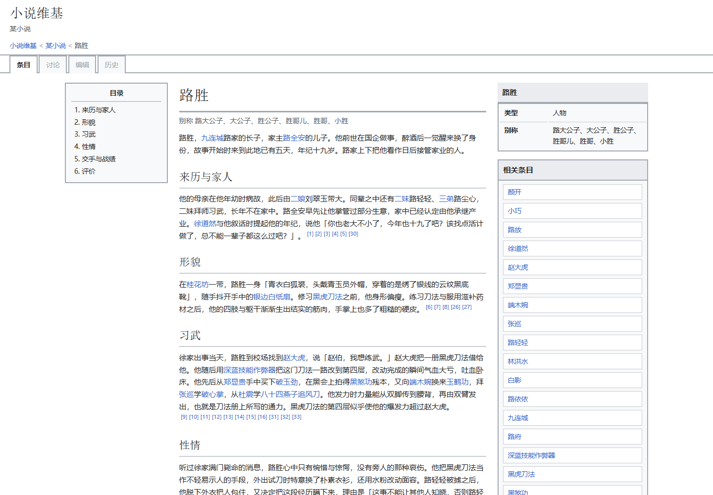
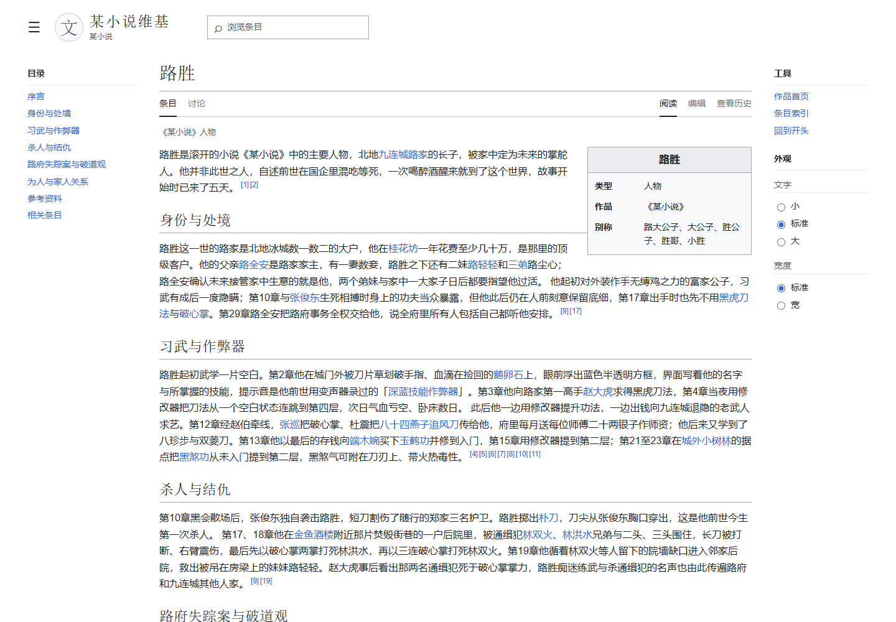
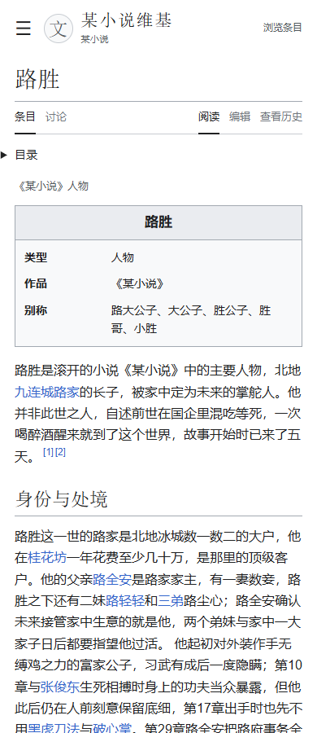

# 某小说前三十章：v0.2 与 v0.2fix 对照试验报告

测试日期：2026-10-14；北京时间。

## 结论

两组均完成第1至30章。按运行时段估算费用为旧版 33.82 元、fix 4.55 元；统一单价后为 26.24 元、4.40 元，降低 83.23%。模型调用减少 84.02%，耗时减少 71.28%。

但 fix 条目从 113 减为 82，正文从 48,691 字符减为 22,969 字符，减少 52.83%。按千字正文归一化费用仍降低 64.45%，但信息密度与细节覆盖不等价，不能称为等质节省 83.23%。

本次可以确认：成本和耗时下降，Vector 2022 布局及目录/字号/宽度控件可用，引用与时间线规则检查更干净。语义抽查仍发现主语错配和无依据能力扩写，正文仍大量按章节推进；语言与事实归属尚未完全解决。

费用降低必须结合条目数、正文量、覆盖线索与错误项一起解释。单次 A/B 只能证明这次运行的观察，不能推断所有作品或所有运行均有同等收益。

## 条件与方法

输入固定为某小说的前30章，共 105,785 字符（含标题、空白），两组字节相同。

模型为 DeepSeek-V4.1-Flash，API 标识 deepseek-flash，provider 为 deepseek-official；两组配置 high 思考强度。[官方模型说明](https://api-docs.deepseek.com/zh-cn/quick_start/pricing/)。

A 加载冻结的 v0.2 分发包，B 加载冻结的 v0.2fix 分发包。相同任务请求、路径规范与权限环境；各自运行自己的六步流程。fix 未覆盖参数，采用默认 balanced。

顺序为 A 后 B，不共享对方产物。未设费用上限。只在标准产物缺失时使用相同的通用续跑提示，不按统一质量评测结果替某组改稿。

测试脚本最初只识别顶层 chapters_read，新版将明确的数字30写在 source.chapters_read 下，因此误判并额外续跑检查两次。之后修正解析并确认完整；这两次的用量与耗时全部保留在 B 组，未新增审查、未修改正文。A也有一次完成记录格式续跑。

运行结束后复核输入及分发包文件：A检查169个文件，B检查180个文件，均与冻结版本相同。

费用包含主 session 与子代理的有记录模型用量，按消息 id 去重；失败重试有用量时纳入，缺用量事件单列。评测与协调程序的开销不混入生成组。

生成结束后，使用同一份冻结原文与统一校验器评估出处、引用、正文人称、数据与页面。浏览器按1440px桌面和390px窄屏检查。

统一校验器取自冻结的 fix 分发包，两组均用相同脚本运行；引用编号与节级绑定规则比旧版自检严格。结果表示对这一统一标准的符合程度，不等于独立语义裁判。

## 实测对照

| 指标 | v0.2 | v0.2fix |
| --- | ---: | ---: |
| 完成状态 | completed | completed |
| 执行尝试数（含续跑检查） | 2 | 3 |
| 耗时（分钟） | 128.1579 | 36.8116 |
| 模型调用（有用量记录） | 2,259 | 361 |
| 工具调用合计 | 3,194 | 433 |
| session 数（含主 session） | 71 | 7 |
| 未缓存输入 tokens | 6,363,076 | 691,501 |
| 缓存读取 tokens | 231,307,648 | 71,974,784 |
| 输入缓存读取占比（%） | 97.3227 | 99.0484 |
| 输出 tokens（含模型报告的思考用量） | 3,813,549 | 567,493 |
| 按实际时段价格估算（元） | 33.8161 | 4.5504 |
| 统一空闲单价归一化（元） | 26.2434 | 4.4010 |
| 最终条目数 | 113 | 82 |
| 正文字符数 | 48,691 | 22,969 |
| 归一化费用/条目（元） | 0.2322 | 0.0537 |
| 归一化费用/千字正文（元） | 0.5390 | 0.1916 |
| 引文来源条数 | 1,412 | 322 |
| 引文或节级引用校验失败项 | 113 | 0 |
| 其中原文章节/引文失败项 | 2 | 0 |
| 每百条来源的原文校验失败项 | 0.1416 | 0.0000 |
| 条目引用涉及章节数 | 30 | 30 |
| 条目 id/名称/相关链接失败项 | 0 | 0 |
| 正文人称规则命中项（需复核） | 5 | 0 |
| 已确认人称错误（仅命中项复核） | 0 | 0 |
| 已确认人称误报 | 5 | 0 |
| 代词候选线索（非已确认错误） | 64 | 31 |
| 表结构及时间线失败项 | 7 | 0 |
| 站点文件与锚点失败项 | 0 | 0 |
| 关键实体名称命中 | 11/11 | 11/11 |
| 桌面目录跳转可用 | 否 | 是 |
| 外观控件数 | 0 | 5 |
| 字号控件改变实际字号 | — | 是 |
| 1920px宽屏控件改变正文宽度 | — | 是 |
| 390px 窄屏横向溢出 | 否 | 否 |
| 浏览器外部资源请求 | 0 | 0 |

## 产出规模与审查工作

旧版条目类型分布：{"character": 30, "place": 32, "object": 30, "event": 21}。

fix 条目类型分布：{"character": 34, "place": 21, "object": 13, "event": 10, "race": 4}。

### 结构化记录量

| 表 | v0.2 | v0.2fix |
| --- | ---: | ---: |
| 人物 | 71 | 67 |
| 地点 | 72 | 38 |
| 物品 | 150 | 60 |
| 种族 | 6 | 13 |
| 人物时间线 | 126 | 64 |
| 物品时间线 | 44 | 17 |
| 互动 | 122 | 82 |
| 动态属性取值 | 91 | 21 |

记录量受去重、分类层级和建模粒度影响，不直接等于完整率。没有全量人工标注的实体/事件标准答案，不能据这些数量判定细节覆盖完全相同。

审查子任务按执行日志的任务标签识别；这是调用行为统计，不用成品中的自行申报数字代替。

- v0.2：识别到 21 个审查相关子 session，合计 575 次有用量的模型调用。
- v0.2：识别到 11 个返工相关子 session，合计 524 次有用量的模型调用。
- v0.2：失败尝试 3 次，缺用量事件 3 个；token 分桶差值为 0。
- v0.2fix：识别到 1 个审查相关子 session，合计 11 次有用量的模型调用。
- v0.2fix：识别到 0 个返工相关子 session，合计 0 次有用量的模型调用。
- v0.2fix：失败尝试 0 次，缺用量事件 0 个；token 分桶差值为 0。

同一轮可启动多个审查子任务，子 session 数不是审查轮数。以上只按可识别的子任务标签分类，主 session 的生成、调度与修正混合工作未拆分。

## 语言、出处与界面

人称规则命中项需结合上下文复核。例如‘某人本人’是第三人称，可以产生误报；不能直接把命中数称为实际人称错误。代词线索只是候选，也不算已确认语义错误。

旧版5处人称命中均为‘他本人’‘角色名本人’或‘寄卖者本人’，逐项复核为第三人称误报。命中项复核不能证明全文所有指代问题均已排除。

引用失败分类：旧版{"引用编号/缺失引用": 95, "正文引文与节级来源不匹配": 16, "原文章节/引文": 2}；fix {}。

旧版95项编号/缺失引用失败主要是导语未提供 lead_refs；这是统一格式标准的失败，不能说成95处事实错误。16项正文引文绑定失败也需与实际引文内容、所绑来源分别解释。

旧版两处原文校验失败经回查确认是错章：所标第7章的引文实际在第8章，所标第1章的引文实际在第2章；内容存在于输入，不算凭空虚构。旧版七个时间线失败为首次出现记录提前收口，结束章号早于实体首次出现章号。

引文检查回查冻结原文的所标章节，并检查节级 refs；字面正确仍不等于转述含义完全正确。失败项需区分错章、缺编号、引文不匹配与排版差异。每百条来源计的是失败项数，同一来源可能有多项失败，不是错误来源比例。

关键实体名称命中只衡量是否提及预先指定且确在原文出现的实体，不证明其生平、关系与事件已完整覆盖。

本样本以第三人称叙事为主，对第一人称作品中特有的角色口吻泄漏检验有限。

## 共同条目与语义抽查

预先指定6个实体；随机标签展示，核对导语、前两节及相关原文。主助理知道试验设计，不是独立第三方盲评；没有另起DSH审查，没有全库错误率推断。

| 样本 | 观察 |
| --- | --- |
| 路胜 | fix导语明确作者、作品和虚构人物语境；旧版导语直接进入家世。fix不在导语断言十九岁，完成记录明确年龄依据不足；这是更保守的处理。两个版本仍有剧情复述。 |
| 小巧 | 两版保留十二岁与侍女身份。fix更短，但‘习练内功、能听出内气’缺乏原文支持，所挂引用也不支持这项能力。 |
| 赵大虎 | fix对武艺排行保留‘路胜判断’，观点归属更明确。旧版保留较多形貌、授艺过程和直接台词；fix正文仍按章号推进。 |
| 端木婉 | fix退房段落明确区分掌柜说法与路胜直觉，但交易段落把隐藏身份的主体写反。归属改善不稳定。 |
| 九连城 | 两版提及城市、时局与周边。旧版把‘已查破’先写成事实，后面又引用路胜认为并未查破，信中说法与主角判断的关系不够清晰。fix较短且仍混有按章复述；没有逐句完整判定两版的全部地理与时局断言。 |
| 黑虎刀法 | 旧版存在同名条目；fix精确同名未命中，另有‘黑虎刀法册子’和‘路胜得授黑虎刀法并初见作弊器’条目。没有替换预定样本或给缺失样本补评分；不能称其完全遗漏刀法内容。 |

导语的作品语境、少量观点归属与不确定性处理有改善；正文仍大量按章号复述，并残留主语错配和无依据能力扩写。不能以机械检查零失败宣称语义质量不降或全面提升。

明确例子：新版端木婉条目写“她的身份被路胜隐藏也没能瞒住”，而第12章说“我隐藏身份面貌”的是路胜。新版小巧条目写其能听出内气动静，本段唯一引用为第1章“又上当了啊”，不能支持该能力；第14、23章相关练功者是路胜，小巧负责等候、送饭或递信。以上是有限抽查发现的问题，不推算全库错误率。

两组均未在规则命中复核中确认第一第二人称泄漏，因此本次第三人称小说样本不能证明第一人称作品的人称问题已经修好。新版仍有31条代词候选，未把这些候选当作实际错误或要求清零。

## 页面效果

同一人物页，1440×1000桌面快照。旧版最终产物已由其运行流程修过窄屏样式；两组390px窄屏均未横向溢出，不能把这一项宣传为本次独有提升。

v0.2：

v0.2fix：

旧版目录为静态列表；新版8个目录链接可定位，5个外观单选控件存在，字号切换和1920px宽屏正文宽度切换均经实际操作验证。两组都未请求外部资源。

390×900手机快照中，旧版先展示右栏和长相关条目列表，第一屏还看不到正文；新版将目录折叠、信息框纳入内容，第一屏已能读到导语。这里只评价这两个实际快照中的阅读顺序。

v0.2 手机：

v0.2fix 手机：

A首次有两次不受支持的模型别名尝试，均失败且没有用量记录；成功调用均使用配置的 deepseek-flash/high。A另有一次无用量失败事件。B没有失败事件。

这次版本对照同时改变了指引、校验器、分工和审查上限，不能把全部节省只归因于 balanced=1。A使用20个逐章追加作业和8批独立条目写作；B用5批资料抽取、主流程集中整理，并从资料生成逐章追加产物。B主流程也有局部修正，返工子 session 为0不等于零返工。

## 费用口径与局限

按官方价格，空闲时段每百万 tokens 为未缓存输入1元、缓存读取0.02元、输出4元；高峰均为两倍。高峰窗口按北京时间工作日9–12点、14–18点计算。[官方价格](https://api-docs.deepseek.com/zh-cn/quick_start/pricing/)，查询日期2026-10-14。

时段费用按模型步骤或重试开始时间匹配峰谷窗口估算，不是服务端实扣账单。统一单价归一化费用消除了两组跨峰谷窗口的单价差，但没有消除缓存命中率与先后顺序的影响。

用量日志估算不是账户账单；未报告用量的请求或附属标题生成可能未计入。两组仅各一次，不具有统计显著性，不能承诺通用降幅。

费用或耗时更低但条目少、正文少、未完成或错误更多时，不能仅据成本宣称等质提升。

## 复现资料

[匿名摘要数据](summary.json)包含用量、质量检查、界面检查及输入和版本指纹；已移除本机进程与 session 标识。

输入 SHA-256：21bedc388bd4f4762a5c93a37f1fd82ca8c40c5c5d0009254d7973e653643505。

v0.2 包 SHA-256：1e089bfefff217b9681f13296bd60e75da11631c5d49f6f467c866484fbe3d47。

v0.2fix 包 SHA-256：97a998d243d0aa9fd2ba729b80de8f0d00a785c313ed3ba8bc9e6632e8c3d539。

原始运行日志和产物保存在本机 A、B 独立目录；报告与摘要数据对作品名进行替换。原始文本与 session 不对外发布。

资料：[DeepSeek 模型与价格](https://api-docs.deepseek.com/zh-cn/quick_start/pricing/)；查询日期2026-10-14。

## 可直接展示的实测说明

同一份某小说前三十章、同一个模型和思考强度，旧版生成113条目，fix生成82条目。统一单价后，本次估算成本降低83.2%，千字正文成本降低64.5%；目录、字号和宽度控件也能实际使用。正文比旧版短52.8%，还存在主语归属与无依据扩写的问题，语义质量需要继续修。

上述数字仅限这次实测，不使用“质量完全不降”“通用省八成”“零幻觉”等无法由本试验支持的表述。
